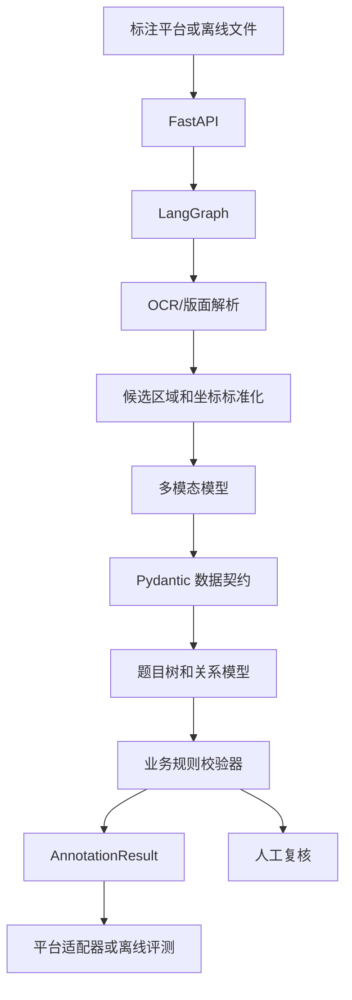

# annotation-agent

面向教育题目的多模态智能标注与审核 Agent。

[](https://github.com/OGGIoao/annotation-agent/actions/workflows/tests.yml)

> 项目状态：早期开发阶段（M0/M1 准备阶段）
>
> 当前重点不是直接自动提交生产任务，而是先建立可验证的离线标注引擎。

## 项目是什么

教育题目的智能标注并不只是 OCR。系统需要理解题目版面和业务规则，并输出可被标注平台使用的结构化结果：

- 题目框、子题框和答案框；
- 父子题、跨栏、跨页关系；
- 独立答案关联；
- 回填答案和答案框绑定；
- 学科、题型、虚线类型和答案封闭性；
- 坐标、关系和业务规则校验；
- 低置信度任务的人工复核原因。

核心链路：

```text
页面输入
  → OCR/版面解析
  → 题目候选区域
  → 多模态结构理解
  → 题目树与答案关系
  → 业务规则校验
  → 局部修正或人工复核
  → 结构化标注结果
  → 后续平台适配
```

## 重要设计原则

### 模型负责理解，程序负责约束

模型用于：

- 判断题目边界和公共题干；
- 识别子题和复合题结构；
- 提出题型、答案和关系候选；
- 判断封闭性并提供置信度和证据。

程序用于：

- 统一页面坐标；
- 生成稳定 ID；
- 构建题目树；
- 校验父子、跨栏、跨页和答案关系；
- 执行显式业务规则；
- 验证模型输出结构；
- 生成最终结果。

人工用于：

- 处理低置信度样本；
- 处理规则冲突；
- 处理复杂视觉题；
- 确认平台无法自动验证的结果。

**模型输出不能绕过 Pydantic 和业务规则校验，也不能直接写入生产平台。**

## 当前阶段

当前仓库已经完成：

- Python 3.12 项目环境；
- `uv` 依赖管理；
- FastAPI、LangGraph、Pydantic v2、pytest 等基础依赖；
- 基础目录骨架；
- 数据和密钥忽略规则；
- GitHub Actions 基础 CI；
- 最终架构和流程图文档；
- 第一批数据契约（`app/contracts/models.py`）：`BoundingBox`、`QuestionNode`、`AnswerBox` 及学科、题型、虚线类型、答案模式、封闭性枚举；
- 第一批确定性校验器（`app/rules/validators.py`）：页面边界、父子层级（父题存在、同页、包含、无环、题目 ID 不重复）、答案绑定（题目存在、答案 ID 不重复）。

当前尚未完成：

- 其余数据契约：`TaskPackage`、`AnnotationResult`、`RuleTrace`、`ReviewRecord`、`ActionPlan`、`ExecutionReceipt`；
- 数学规则文件 `rules/math.yaml` 和规则案例；
- 脱敏金标准数据；
- PaddleOCR/PP-StructureV3 接入；
- 多模态模型适配器；
- 结果可视化；
- 标注平台适配器；
- 生产任务自动提交。

仓库目前是工程骨架，不要把现阶段理解为已经可以自动标注生产任务。

## 第一版范围

第一版先聚焦数学基础题型：

- 选择题；
- 填空题；
- 判断题；
- 口算题；
- 计算题；
- 解答题；
- 连线题。

第一版优先支持：

- 单题框；
- 父子题框；
- 跨栏关系；
- 相邻页跨页关系；
- 独立答案关联；
- 有答案、二维码答案、无答案判断；
- 虚线类型；
- 回填答案；
- 答案封闭性；
- 规则错误和低置信度转人工。

暂不承诺：

- 全学科、全题型覆盖；
- 自动听力识别；
- 复杂作图题；
- 手写答案识别；
- 自动扫码取答案；
- 生产平台自动提交；
- 十秒内处理所有页面。

## 技术栈

| 层次 | 技术 | 作用 |
|---|---|---|
| 运行环境 | Python 3.12 | 统一 API、规则、OCR、模型和评测开发 |
| 接口层 | FastAPI | 任务创建、状态查询、结果和复核信息接口 |
| 编排层 | LangGraph | 节点、状态、分支、恢复和人工介入 |
| 数据契约 | Pydantic v2 | 约束模型输入输出，防止结构漂移 |
| 页面解析 | PaddleOCR / PP-StructureV3 | OCR、版面、表格、公式和坐标候选 |
| 理解层 | 多模态模型 API | 题目结构、题型、答案和关系候选 |
| 原型存储 | SQLite + 本地文件 | 早期离线开发 |
| 生产存储 | PostgreSQL + 对象存储 | 任务、审计、结果和图片文件 |
| 异步任务 | Redis / Celery（按需） | 排队、Worker 和失败重试 |
| 质量保障 | pytest + 固定金标准 | 规则回归、准确率和性能评测 |

首轮多模态模型候选为 Qwen3-VL Instruct，但模型必须通过适配器接入，不能把具体模型写死在业务逻辑中。

## 系统边界



职责边界：

- FastAPI 不直接承担模型推理；
- LangGraph 不计算框坐标、不隐式决定规则；
- OCR 不等于题目拆分；
- 模型只生成候选，不能跳过校验；
- 平台适配器独立于内部领域模型；
- 生产提交必须在测试任务验证后再考虑。

## 设计说明

当前最终设计总图与设计说明见：[ARCHITECTURE-DESIGN.md](docs/ARCHITECTURE-DESIGN.md)。

最终流程图集见：[ARCHITECTURE-FLOWS.md](docs/ARCHITECTURE-FLOWS.md)。

手机查看版 Word 文档见：[ARCHITECTURE-DESIGN.docx](docs/ARCHITECTURE-DESIGN.docx)。

当前项目状态与后续计划见：[PROJECT-STATUS.md](docs/PROJECT-STATUS.md)。

## 开发路线

详细阶段计划和当前执行顺序见：[PROJECT-STATUS.md](docs/PROJECT-STATUS.md)。

当前顺序：

1. 数据契约；
2. 确定性校验；
3. 人工构造案例；
4. OCR/版面解析；
5. 多模态理解；
6. LangGraph 编排；
7. FakeExecutor；
8. 测试平台；
9. 生产评估。

## 仓库结构

```text
annotation-agent/
├── app/
│   ├── api/                 # FastAPI 路由
│   ├── graph/               # LangGraph 状态、节点和边
│   ├── contracts/           # Pydantic 数据契约
│   ├── parsing/             # OCR、版面和坐标变换
│   ├── vision/              # 多模态模型适配器
│   ├── domain/              # 题目树、框和关系领域模型
│   ├── rules/               # 规则匹配和校验器
│   ├── storage/             # SQLite/本地文件
│   └── observability/       # 日志、指标和追踪
├── rules/                   # YAML 业务规则
├── tests/
│   ├── unit/                # 单元测试
│   ├── rule_cases/          # 规则案例
│   └── evaluation/          # 固定数据集评测
├── gold-data/               # 脱敏、可提交的金标准
├── sample-data/             # 本地真实数据，不提交
├── scripts/                 # 导入、评测和导出脚本
├── docs/                    # 设计、决策和路线文档
├── artifacts/               # 本地运行产物，不提交
├── pyproject.toml
├── uv.lock
└── README.md
```

## 快速开始

### 1. 获取代码

```bash
git clone https://github.com/OGGIoao/annotation-agent.git
cd annotation-agent
```

### 2. 安装依赖

项目使用 `uv` 和 Python 3.12：

```bash
uv sync
```

### 3. 运行测试

```bash
uv run pytest
uv run python -m compileall app tests
```

### 4. 配置本地环境

```bash
cp .env.example .env
```

真实 API Key 只放入 `.env`，不要提交到 Git。当前阶段没有要求配置模型 API，先完成契约和规则开发。

## 数据准备

真实样本不进入公开仓库。将本地文件放在：

```text
sample-data/raw-pages/
sample-data/answer-pages/
sample-data/existing-labels/
```

脱敏后的标准结果放在：

```text
gold-data/
```

第一批样本建议包含普通题、父子题、跨栏、跨页、无答案题、复合题和连线题。没有真实页面、答案页和金标准，就不能可靠评估 Agent 是否有效。

## 协作方式

### 新协作者先读什么

1. 本 README：了解目标、范围、最终架构和当前状态；
2. `docs/ARCHITECTURE-DESIGN.md`：了解系统设计说明；
3. `docs/ARCHITECTURE-FLOW.md`：了解最终业务流程图；
4. `AGENTS.md`：了解仓库边界和开发约束；
5. 具体任务对应的规则和测试案例。

### 开发原则

- 新增题型或规则：先写规则案例，再写实现；
- 模型输出：必须经过 Pydantic 和业务校验；
- 坐标变换：必须保留原始页面坐标和变换信息；
- 平台接入：通过独立 Adapter；
- 不确定结果：进入人工复核，不要静默通过；
- 每个改动：补测试、说明影响并运行 CI 检查。

### 分支和提交

```text
main                    # 稳定主线
feat/contracts          # 数据契约
feat/rules-math         # 数学规则
feat/ocr-adapter        # OCR 适配
feat/graph              # 流程编排
feat/evaluation         # 评测
fix/<short-description> # 问题修复
```

提交示例：

```text
feat: add annotation contract models
feat: add math no-answer rules
fix: validate cross-page relation
docs: clarify answer source policy
```

提交前运行：

```bash
uv run pytest
uv run python -m compileall app tests
git diff --check
```

## 安全和开源注意事项

仓库目前处于早期阶段，公开协作前必须确认数据已脱敏。严禁提交：

- API Key、登录凭据和密码；
- 真实题目、答案或用户图片；
- 内部任务 ID；
- 未脱敏平台接口；
- 包含敏感信息的模型响应。

检查敏感信息：

```bash
git grep -n -I -E 'sk-|token|password|secret|api[_-]?key' -- . ':!uv.lock'
git status --short
git diff --check
```

## 当前下一步

按照成熟 Agent 工程的顺序，下一步不是直接接模型，而是：

1. 确定第一批数学样本；
2. 定义脱敏金标准 JSON；
3. 补齐 `AnnotationResult` 等剩余数据契约（基础框、题目、答案模型已完成）；
4. 在 `tests/rule_cases/` 补充坐标和关系规则案例（基础校验器已有单元测试）；
5. 创建第一版 `rules/math.yaml`；
6. 用人工构造数据跑通校验器；
7. 再接 OCR 和多模态模型。

先让业务底座“不会乱”，再让模型“看得懂”，最后才让平台“自动执行”。