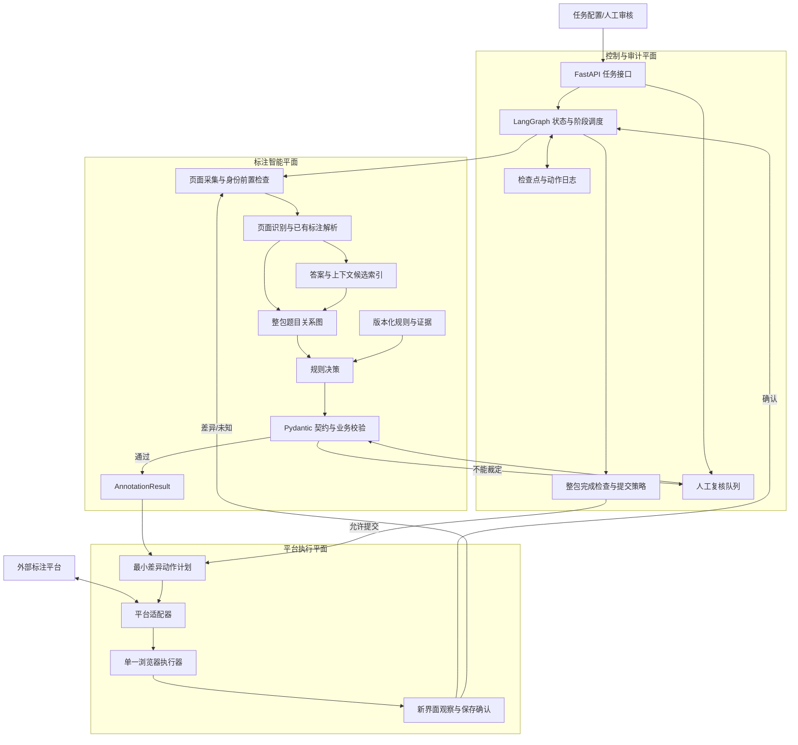

# 参考架构对比与本项目架构升级建议

> 参考：用户提供的“平台任务与比赛窗口—LangGraph—浏览器执行器”架构图。
>
> 目的：判断参考图中哪些设计适合题目标注 Agent，哪些不能直接照搬，并形成我们自己的最终架构方向。

## 1. 先给结论

参考图不是 OCR 或题目标注算法图，而是一个更完整的：

> **平台任务自动化与结果确认闭环图**

它重点解决：

- 如何进入指定平台任务；
- 如何确认身份和当前界面；
- 如何用 LangGraph 管理任务阶段；
- 如何记录检查点和动作日志；
- 如何做规则与业务校验；
- 如何生成最小差异操作；
- 如何通过单一浏览器执行；
- 如何观察保存结果并反馈；
- 如何把不能裁定的情况交给人工。

我们当前的设计重点是：

> **页面理解、题目结构、答案关联、回填生成和标注规则校验。**

因此，两者不是互相替代的两张图，而是上下游关系：

```text
我们的标注智能层
    ↓ 生成结构化 AnnotationResult
参考图的平台执行闭环
    ↓ 在标注平台中完成最小差异操作并确认保存
```

最终应把两者合并成“标注智能层 + 平台执行层 + 状态审计层”的三层架构。

## 2. 参考图识别结果

参考图中清晰可见的节点包括：

1. 指定平台任务与比赛窗口；
2. 界面采集与身份核对；
3. LangGraph 任务状态与阶段调度；
4. 页面识别与已有标注解析；
5. 答案与上下文索引；
6. 检查点与动作日志；
7. 整包完成检查及提交策略；
8. 整包题目关系图；
9. 版本化规则与证据；
10. 规则决策；
11. 契约与业务校验；
12. 最小差异动作计划；
13. 单一浏览器执行器；
14. 人工处理具体问题；
15. 新界面观察与保存确认。

分支和反馈包括：

- 契约校验通过 → 最小差异动作计划；
- 契约不能裁定 → 人工处理具体问题；
- 人工修改 → 重新校验；
- 执行后确认 → 回到 LangGraph 状态调度；
- 差异或结果未知 → 回到界面采集与身份核对。

这张图没有明确给出具体 OCR、模型、数据库、浏览器框架或云部署方式，所以我们只借鉴它的流程思想，不把它的功能节点误认为已经确定的技术实现。

## 3. 与我们当前设计的对照

| 参考图节点 | 我们当前对应设计 | 判断 |
|---|---|---|
| 指定平台任务与比赛窗口 | FastAPI 输入任务元数据 | 需要补强 |
| 界面采集与身份核对 | 当前只考虑图片输入，平台适配尚未完成 | 明显缺口 |
| LangGraph 任务状态与阶段调度 | LangGraph 编排层 | 已覆盖 |
| 页面识别与已有标注解析 | OCR/PP-StructureV3 + 页面解析 | 已覆盖 |
| 答案与上下文索引 | 答案页、答案来源和候选匹配 | 已覆盖，但应结构化 |
| 检查点与动作日志 | 版本、审计和中间状态 | 已提到，尚未形成独立设计 |
| 整包完成检查及提交策略 | 当前只做离线结果，不做整包提交 | 后续补入 |
| 整包题目关系图 | 题目树、父子、跨栏、跨页、答案关系 | 需要升级为整包级模型 |
| 版本化规则与证据 | YAML 规则、规则版本、证据块 | 已覆盖 |
| 规则决策 | Python 规则匹配和校验器 | 已覆盖 |
| 契约与业务校验 | Pydantic + 业务校验器 | 已覆盖 |
| 最小差异动作计划 | 当前没有平台动作计划模型 | 明显缺口 |
| 单一浏览器执行器 | 计划中的 Platform Adapter，尚未具体化 | 后续补入 |
| 人工处理具体问题 | 低置信度/规则冲突进入人工复核 | 已覆盖 |
| 新界面观察与保存确认 | 当前没有执行后的 UI 观察闭环 | 明显缺口 |

## 4. 我们应采用的升级后总架构

建议将系统拆成三个平面，而不是把所有功能放进一个 Agent：

### 4.1 标注智能平面

负责“看懂题目并生成标注结果”：

- 页面解析；
- 题目候选；
- 多模态理解；
- 题目树；
- 答案匹配；
- 回填答案；
- 题型和封闭性；
- 规则决策；
- 标注结果校验。

### 4.2 平台执行平面

负责“把结果变成平台上的动作”：

- 任务领取；
- 页面和身份核对；
- 已有标注读取；
- 内部结果到平台 Payload 的转换；
- 最小差异动作计划；
- 单一浏览器执行；
- 保存结果观察；
- 测试任务提交。

### 4.3 控制与审计平面

负责“让系统可恢复、可追踪、可复核”：

- LangGraph 状态；
- 检查点；
- 动作日志；
- 模型、OCR、规则和代码版本；
- 人工复核队列；
- 整包完成检查；
- 提交策略；
- 指标和评测。

## 5. 升级后的逻辑架构图



## 6. 两个 Agent 阶段，不是一个大 Agent

参考图容易让人把全部节点理解成“一个 Agent”。不建议这么做。应拆成两个受控的智能阶段：

### 6.1 标注推理 Agent

输入：

- 页面图片；
- OCR/版面结果；
- 已有标注；
- 答案页；
- 规则和证据。

输出：

```text
AnnotationResult
```

它不操作浏览器，不点击平台，不提交任务。

### 6.2 平台执行 Agent

输入：

```text
AnnotationResult + 当前平台页面状态
```

输出：

```text
ActionPlan + ExecutionReceipt
```

它不重新理解整页题目，只执行经过校验的动作，并确认页面是否达到预期状态。

这样可以避免：

- 浏览器状态影响题目判断；
- 页面操作失败导致模型重新猜题；
- 平台 DOM 变化污染题目领域模型；
- 自动化动作和业务规则混在一个 Prompt 中。

## 7. 参考图对我们的关键补充

### 7.1 增加任务入口和身份前置检查

目前我们的输入默认是“已有图片”。真实平台任务需要先确认：

- 当前平台；
- 当前任务；
- 当前任务包；
- 当前账号或会话；
- 当前页面和页码；
- 是否处于允许操作的时间窗口。

身份信息只做状态核对，不把密码写入项目或交给模型。

### 7.2 增加整包级关系图

我们现在的题目树偏向单页或单题。参考图提醒我们，真实任务需要把整包作为一个聚合对象：

```text
TaskPackage
├── Page
│   ├── QuestionNode
│   ├── AnswerBox
│   └── Relations
├── AnswerSource
├── RuleTrace
├── CompletionStatus
└── SubmissionPolicy
```

整包级模型用于处理：

- 跨页题；
- 答案页匹配；
- 子题跨页；
- 整包是否完成；
- 是否存在未确认页面；
- 是否可以进入提交阶段。

### 7.3 增加检查点和动作日志

检查点不是普通日志。它必须允许恢复：

```text
任务接收完成
页面采集完成
解析完成
题目结构完成
规则校验完成
结果生成完成
动作计划生成完成
浏览器执行完成
保存确认完成
```

动作日志至少记录：

- 时间；
- task_id；
- 页面；
- 动作类型；
- 目标对象；
- 动作前状态摘要；
- 动作后状态摘要；
- 是否确认成功；
- 错误和截图引用。

### 7.4 增加最小差异动作计划

内部结果不能直接变成“鼠标点击序列”。中间要有动作计划：

```json
{
  "task_id": "task-001",
  "page_id": "page-03",
  "preconditions": [
    "当前页为 page-03",
    "题目 2 已存在"
  ],
  "actions": [
    {
      "type": "create_answer_box",
      "question_id": "2-1",
      "bbox": [120, 300, 680, 350]
    },
    {
      "type": "set_line_type",
      "question_id": "2-1",
      "value": "实线"
    }
  ],
  "expected_observations": [
    "答案框 2-1 出现",
    "题目 2-1 虚线类型为实线"
  ]
}
```

动作计划需要满足：

- 只修改必要字段；
- 不能破坏已有正确标注；
- 执行前有前置条件；
- 执行后有预期观察；
- 失败时可以定位到具体动作。

### 7.5 增加执行后的观察确认

“点击保存”不等于“保存成功”。需要观察：

- 页面是否出现预期框；
- 关系颜色或标签是否变化；
- 保存按钮状态是否改变；
- 是否出现错误提示；
- 页面刷新后结果是否仍存在；
- 当前任务是否进入下一状态。

执行闭环应是：

```text
生成动作
→ 检查前置条件
→ 单一浏览器执行
→ 观察页面
→ 验证预期结果
→ 记录回执
```

## 8. 我们不应直接照搬的部分

### 8.1 不先做“比赛窗口”复杂调度

参考图中的比赛窗口可能是其业务背景。我们的第一版应抽象成：

```text
TaskWindow / TaskMetadata
```

先支持任务、任务包、页码和截止时间，不提前实现复杂竞赛调度。

### 8.2 不先做通用答案与上下文索引

当前答案来源主要是：

- 书籍答案页；
- 二维码答案；
- 听力材料；
- 无答案状态。

第一版使用结构化索引：

```text
教材 → 章节 → 页码 → 题号 → 答案候选
```

暂时不需要向量数据库或图数据库。只有当整书答案检索成为主要瓶颈时，再评估 Haystack、LlamaIndex 或专用检索服务。

### 8.3 不先把浏览器执行器做成自由行动 Agent

浏览器执行器只接受经过校验的 `ActionPlan`，不允许它自由浏览、自由猜测或自行修改规则。

第一版应有：

- 操作白名单；
- 页面和任务范围限制；
- 单一浏览器上下文；
- 执行前置条件；
- 执行后观察条件；
- 最大动作数；
- 超时和停止机制；
- 测试任务开关。

### 8.4 不把“人工处理”当成失败黑洞

人工复核必须有结构化原因，不允许只标记“模型不确定”：

```text
QUESTION_BOUNDARY_UNCERTAIN
ANSWER_MATCH_AMBIGUOUS
RELATION_CONFLICT
RULE_CONFLICT
COORDINATE_INVALID
PLATFORM_STATE_UNKNOWN
```

这样才能统计哪些问题值得后续优化。

## 9. 技术实现建议

### 第一版内部对象

建议新增三个领域对象：

```text
TaskPackage
ActionPlan
ExecutionReceipt
```

与已有对象的关系：

```text
TaskPackage
  ├── AnnotationResult
  ├── RuleTrace
  ├── ActionPlan
  ├── ExecutionReceipt
  └── ReviewRecord
```

### 平台执行器选型

平台没有明确 API 时，优先评估：

1. Playwright：适合浏览器上下文、截图和 DOM 操作；
2. CDP：需要更底层控制或平台是 Canvas 时使用；
3. Selenium：只有已有 Selenium 基础设施时考虑。

最终选型要先检查目标平台是否使用 DOM、Canvas、SVG 或自定义事件，不能只看框架流行度。

### 存储建议

原型阶段：

- SQLite：任务状态、关系、动作计划和回执；
- 本地文件：页面、截图、模型响应和执行证据。

生产阶段：

- PostgreSQL：结构化任务和审计；
- 对象存储：图片、截图和证据；
- Redis：队列或短期状态；
- LangGraph checkpoint：图状态恢复。

## 10. 调整后的开发顺序

参考图使我们的路线需要做一个调整：平台执行层不应最后才突然出现，而应提前定义接口，但延后实现真实浏览器操作。

### M0：业务规则和数据基线

保持不变：先整理数学样本、答案页和金标准。

### M1：标注领域模型

新增明确对象：

- `TaskPackage`；
- `AnnotationResult`；
- `RuleTrace`；
- `ReviewRecord`；
- `ActionPlan`；
- `ExecutionReceipt`。

先写接口和校验，不接浏览器。

### M2：页面解析和标注推理

完成 OCR、候选区域、多模态理解和题目关系图。

### M3：规则门禁和人工复核

完成契约校验、业务校验、低置信度分流和最多一次局部修正。

### M4：动作计划和执行回执

用模拟执行器测试：

```text
AnnotationResult → ActionPlan → FakeExecutor → ExecutionReceipt
```

先不碰真实平台。

### M5：测试平台浏览器适配

在测试任务中验证：

- 页面采集；
- 身份核对；
- 已有标注读取；
- 最小差异操作；
- 保存确认；
- 差异回采集。

### M6：整包闭环和生产评估

加入：

- 整包完成检查；
- 提交策略；
- 检查点恢复；
- 动作审计；
- 性能和转人工评测。

## 11. 最终对比结论

参考图比我们当前设计多了一个关键维度：

> **它把“结果生成”推进到了“平台执行并确认保存”。**

我们当前设计的优势是：

- 题目标注规则更具体；
- 题目框、答案框和关系定义更细；
- OCR、模型、规则和契约边界更清楚；
- 离线评测路线更明确。

我们当前设计的缺口是：

- 平台任务入口；
- 身份和界面前置检查；
- 整包状态；
- 检查点和动作日志；
- 最小差异动作计划；
- 单一浏览器执行器；
- 执行后的保存确认；
- 提交策略。

升级后的目标不是复制参考图，而是形成：

```text
题目标注智能层
+ 规则和证据层
+ 任务状态与审计层
+ 平台执行与观察层
+ 人工复核闭环
```

最稳的实施原则：

> 先做离线标注结果，再做动作计划；先做 FakeExecutor，再做测试平台；先确认保存，再考虑生产提交。
