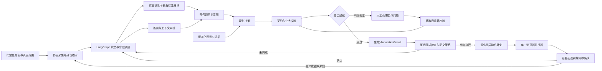

# 标注 Agent 总设计与复杂度说明

## 项目定位

这是一个面向教育题目标注的 Agent 系统。它不是单纯的 OCR，也不是只会在网页上点击的自动化脚本，而是把三类能力串起来：

1. **标注智能**：看懂题目页面、题目结构、答案和规则；
2. **结果校验**：确认坐标、题目关系、答案绑定和业务属性没有冲突；
3. **平台执行**：在经过校验后，生成并执行最小差异动作，确认平台保存成功。

## 完整主流程

```text
任务进入
  → 页面与身份确认
  → 页面解析
  → 题目结构理解
  → 题目关系与答案匹配
  → 规则与契约校验
  → AnnotationResult
  → ActionPlan
  → 单一浏览器执行
  → 保存观察
  → ExecutionReceipt
  → 状态推进、人工复核或重新采集
```

## 设计总图



## 三个平面

### 1. 标注智能平面

负责：

- OCR 和版面解析；
- 题目边界和公共题干；
- 子题和复合题结构；
- 父子、跨栏、跨页关系；
- 答案页和答案来源；
- 回填答案；
- 题型、虚线类型和封闭性；
- 生成 `AnnotationResult`。

### 2. 平台执行平面

负责：

- 任务和页面采集；
- 身份和页面状态确认；
- 生成 `ActionPlan`；
- 执行前置条件检查；
- 单一浏览器执行；
- 保存观察；
- 生成 `ExecutionReceipt`。

### 3. 控制与审计平面

负责：

- FastAPI 接口；
- LangGraph 状态和阶段调度；
- 检查点；
- 动作日志；
- 整包完成检查；
- 提交策略；
- 人工复核和运行指标。

## 数据对象关系

```text
TaskPackage
├── Page
├── QuestionNode
├── AnswerBox
├── AnswerLink
├── RuleTrace
├── AnnotationResult
├── ActionPlan
├── ExecutionReceipt
└── ReviewRecord
```

### AnnotationResult

表示：

> 这道题最终应该被标注成什么样。

包含题目框、答案框、题目关系、答案关联、回填答案、题型、虚线类型、封闭性、置信度和版本信息。

### ActionPlan

表示：

> 平台上具体需要做哪些最小修改。

它不是自由点击脚本，而是带有前置条件、动作白名单、预期变化和最大动作数的声明式计划。

### ExecutionReceipt

表示：

> 动作做完以后，平台是否真的变成了预期状态。

点击保存不等于保存成功，必须通过页面观察和回执确认。

## 模型、程序和人工的边界

### 模型负责理解

模型适合判断：

- 题目边界；
- 公共题干；
- 子题归属；
- 题型；
- 答案候选；
- 题目关系候选；
- 答案开放性；
- 置信度和证据。

### 程序负责约束

程序负责判断：

- 坐标是否越界；
- 坐标顺序是否正确；
- 父框是否包含子框；
- 答案框是否绑定正确题目；
- 独立答案是否重复关联；
- 虚线类型是否冲突；
- 输出结构是否合法；
- 是否满足业务规则。

### 人工负责兜底

人工处理：

- 题目边界无法判断；
- 答案页存在多个候选；
- 关系互相冲突；
- 规则文档没有覆盖；
- 平台状态未知；
- 复杂视觉题或低置信度样本。

## 这个设计复杂吗？

### 简短结论

**业务不简单，但当前设计没有小题大做；真正小题大做的是一开始就把全部模块全部实现。**

如果目标只有：

```text
从图片中识别题目位置
```

那么 OCR + 一个视觉模型可能就够了。

但本项目的真实目标是：

```text
理解整包题目
→ 拆分题目和子题
→ 关联答案
→ 生成回填
→ 判断题型和属性
→ 修改平台标注
→ 保存并确认
→ 出错时恢复或人工处理
```

这已经不是单一识别任务，而是一个带状态、规则和外部系统交互的业务流程。

### 专业人士会怎么拆

专业人士一般会把它拆成：

1. 页面和文档理解；
2. 结构化标注生成；
3. 业务规则执行；
4. 结果质量校验；
5. 平台状态操作；
6. 执行结果确认；
7. 失败恢复和人工协同。

这七部分每一部分都可以独立测试。组合起来后，才需要 LangGraph、检查点、动作计划和人工复核。

### 哪些是必要复杂度

以下内容不是堆技术，而是业务本身要求：

- 父子题；
- 跨栏；
- 跨页；
- 独立答案；
- 无答案特殊规则；
- 例题和残题；
- 回填框绑定；
- 题型和封闭性；
- 平台已有标注；
- 保存后结果确认。

如果去掉这些，系统只能做演示，不能覆盖真实标注任务。

### 哪些可以后置

以下内容现在不必实现：

- PostgreSQL；
- 对象存储；
- Redis/Celery；
- 向量数据库；
- 图数据库；
- 全学科；
- 全题型；
- 复杂分布式部署；
- 生产平台自动提交；
- 大模型本地部署。

所以当前策略是：

> 架构完整，实施分期；先做最小闭环，不提前堆基础设施。

## 第一版真正要做什么

第一版只做离线标注引擎：

```text
一页数学题图片
  → OCR/版面解析
  → 题目候选
  → 模型理解
  → Pydantic 校验
  → 业务规则校验
  → AnnotationResult
  → 结果画回原图
  → 固定样本评测
```

第一版暂不做真实浏览器自动提交。

### 第一版范围

- 选择题；
- 填空题；
- 判断题；
- 口算题；
- 计算题；
- 解答题；
- 连线题；
- 单题框；
- 父子题框；
- 基础跨栏和相邻页跨页；
- 基础答案关联；
- 虚线类型；
- 回填答案；
- 封闭性。

### 第一版验收

输入真实页面后，需要做到：

- 输出合法的结构化结果；
- 题目框和答案框能画回原图；
- 关系错误能被发现；
- 规则冲突能被发现；
- 低置信度能进入人工复核；
- 结果可以重复评测。

## 实施顺序


必须坚持：

```text
没有 AnnotationResult，就不能设计可靠的 ActionPlan；
没有 ActionPlan，就不能安全接浏览器；
没有 FakeExecutor，就不应直接操作测试平台；
没有测试平台验证，就不应考虑生产提交。
```

## 最终判断

这套设计不是为了把项目复杂化，而是为了把不同性质的问题分开：

```text
题目标注智能：题目应该标注成什么
规则和契约：这个结果是否合法
平台执行：页面上应该做什么
保存确认：做完之后是否真的成功
```

如果只做 OCR，会漏掉规则和关系；如果只做模型，会缺少稳定性和可追溯性；如果直接做浏览器自动化，则可能把错误快速提交到平台。

因此，专业且稳妥的路线是：

> 先定义结果，再定义动作；先做离线闭环，再做浏览器执行；先做 FakeExecutor，再做测试平台；先确认保存，再考虑生产提交。
