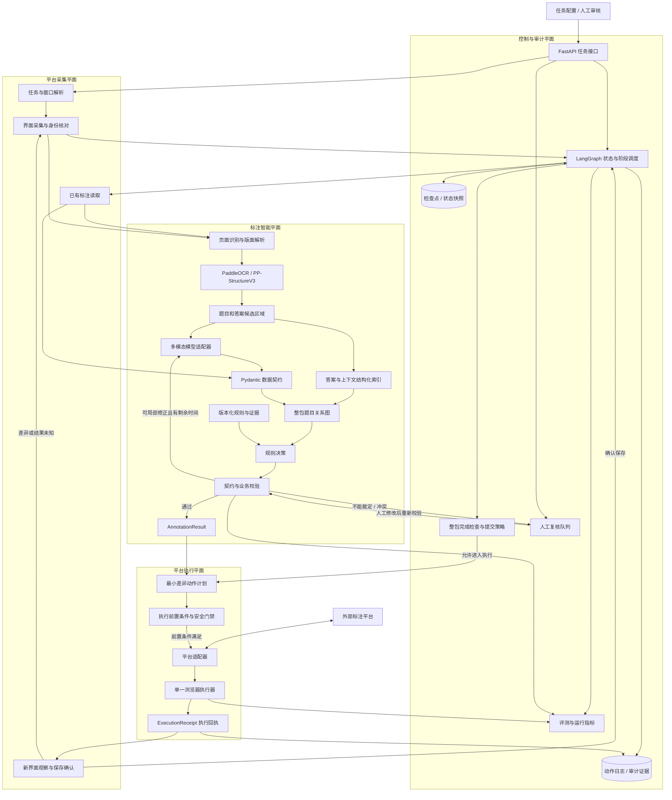

# 标注 Agent 最终设计总图与详细说明

> 版本：v0.3
>
> 参考：题目标注业务规则、当前 `annotation-agent` 技术方案，以及用户提供的平台任务自动化参考图。
>
> 本文是当前阶段的主设计说明，重点回答：系统由哪些平面组成、每个节点做什么、数据如何流动、哪些地方允许模型判断、哪些地方必须由程序控制，以及未来如何接入真实标注平台。

## 1. 一句话架构

```text
任务与页面进入
→ 采集和身份确认
→ 标注智能理解
→ 题目关系与规则决策
→ 契约和业务校验
→ 标注结果
→ 最小差异动作计划
→ 单一浏览器执行
→ 保存观察和结果回执
→ 状态推进、人工复核或重新采集
```

最终系统不是一个“自由行动的大模型”，而是：

> **以 LangGraph 为状态编排器，以规则和契约为质量门禁，以多模态模型为理解器，以单一浏览器为受控执行器，以人工复核为兜底的闭环标注系统。**

## 2. 设计目标

### 2.1 业务目标

让系统能够对教育题目完成：

- 题目框和答案框识别；
- 公共题干和子题结构识别；
- 父子、跨栏、跨页关系建立；
- 独立答案匹配；
- 回填答案生成；
- 学科、题型、虚线类型、答案封闭性判断；
- 已有标注检查；
- 错误、低置信度和不确定任务转人工；
- 在验证通过后生成平台操作动作；
- 执行后确认页面保存结果。

### 2.2 工程目标

系统必须：

- 输出结构稳定；
- 坐标可追溯；
- 规则可版本化；
- 模型可替换；
- 状态可恢复；
- 动作可审计；
- 结果可评测；
- 平台变化不影响核心标注模型；
- 失败不静默通过；
- 不因追求自动化而绕过人工安全门禁。

## 3. 最终总架构图



## 4. 三个核心平面

## 4.1 标注智能平面

这是项目的核心业务能力，负责把页面和答案理解成结构化标注结果。

包含：

- 页面识别和版面解析；
- OCR 和公式/表格候选；
- 题目与答案候选区域；
- 多模态结构理解；
- 答案和上下文索引；
- 整包题目关系图；
- 版本化规则；
- 契约和业务校验；
- `AnnotationResult`。

它不直接操作浏览器，也不直接提交平台任务。

## 4.2 平台执行平面

负责把经过质量门禁的结构化结果变成平台上的受控操作。

包含：

- 任务和界面采集；
- 身份和页面状态确认；
- 平台已有标注读取；
- 平台适配器；
- 最小差异动作计划；
- 执行前安全门禁；
- 单一浏览器执行器；
- 保存观察；
- 执行回执。

它不重新决定题型和业务规则，只执行经过校验的 `ActionPlan`。

## 4.3 控制与审计平面

负责让整个系统可调度、可恢复、可追踪和可评测。

包含：

- FastAPI；
- LangGraph；
- 检查点；
- 动作日志；
- 整包完成检查；
- 提交策略；
- 人工复核队列；
- 指标和评测。

## 5. 端到端业务流程

### 5.1 任务进入

输入可能来自：

- 离线图片和答案页；
- 标注平台任务；
- 人工指定的任务包；
- 测试数据集。

统一转换为：

```text
TaskPackage
```

`TaskPackage` 记录任务、页面、答案来源、当前状态、规则版本和完成情况。

### 5.2 采集与身份确认

在接触平台时，先确认：

- 当前平台是否正确；
- 当前任务和任务包是否正确；
- 当前账号或会话是否正确；
- 当前页面和页码是否正确；
- 页面是否处于可操作状态；
- 是否存在未保存变更。

这一层只确认环境，不把登录密码交给模型，也不把凭据写入代码。

### 5.3 页面识别和已有标注读取

读取：

- 原始页面图片；
- 页面尺寸；
- 现有题目框；
- 现有答案框；
- 题号和属性；
- 平台中的已有关系；
- 当前保存状态。

已有标注不能当成绝对正确，而应当作为模型和规则的输入证据。

### 5.4 OCR 和版面解析

生成页面中间表示：

```json
{
  "page_id": "p001",
  "width": 2480,
  "height": 3508,
  "blocks": [],
  "tables": [],
  "formulas": [],
  "images": [],
  "reading_order": [],
  "parser_version": "..."
}
```

所有内部坐标统一保存为原始页面坐标。裁剪、缩放、旋转必须记录变换关系。

### 5.5 候选区域和答案索引

程序先生成候选：

- 题号区域；
- 小题号区域；
- 题干文字块；
- 横线和作答空白；
- 栏位区域；
- 答案页候选；
- 公式、表格和图片区域。

答案索引第一版使用结构化索引：

```text
教材 → 章节 → 页码 → 题号 → 答案候选
```

暂不因为参考图出现“索引”就直接引入向量数据库或图数据库。

### 5.6 多模态理解

模型按页面或题组提出候选：

- 题目边界；
- 公共题干；
- 子题归属；
- 题型；
- 跨栏和跨页候选；
- 答案来源；
- 回填答案；
- 封闭性；
- 置信度；
- 证据块 ID。

模型输出只进入候选结构，不直接成为最终平台动作。

### 5.7 整包题目关系图

单页题目树不足以解决跨页和答案页关系，因此建立整包级关系：

```text
TaskPackage
├── Page
│   ├── QuestionNode
│   ├── AnswerBox
│   └── LocalRelation
├── CrossPageRelation
├── AnswerSource
├── RuleTrace
├── CompletionStatus
└── SubmissionPolicy
```

整包关系图负责回答：

- 题目是否完整；
- 子题是否漏标；
- 题目是否跨页；
- 答案是否已匹配；
- 是否存在未处理页面；
- 是否可以进入执行或提交阶段。

### 5.8 规则决策和校验

规则决策必须有版本和证据：

```text
学科 + 题型 + 答案来源 + 特殊条件
→ 规则动作
```

规则校验检查：

- 坐标和页面边界；
- 父框是否包含子框；
- 题目编号和答案框编号；
- 父子、跨栏、跨页关系；
- 独立答案是否重复；
- 无答案特殊题处理；
- 例题、残题和虚线类型；
- 回填格式；
- 封闭性和题型冲突。

### 5.9 人工复核

不能裁定时，不生成“猜测性的成功结果”。进入人工复核，并给出结构化原因：

```text
QUESTION_BOUNDARY_UNCERTAIN
ANSWER_MATCH_AMBIGUOUS
RELATION_CONFLICT
RULE_CONFLICT
COORDINATE_INVALID
PLATFORM_STATE_UNKNOWN
```

人工修改后重新进入校验，而不是直接绕过质量门禁。

### 5.10 生成标注结果

输出：

```text
AnnotationResult
```

它是标注智能平面和平台执行平面之间的稳定接口。

### 5.11 生成最小差异动作计划

不能把 `AnnotationResult` 直接转换成盲目点击序列。先生成：

```text
ActionPlan
```

动作计划包含：

- 页面和任务前置条件；
- 要创建、修改、删除或关联的对象；
- 动作顺序；
- 最大动作数；
- 预期页面变化；
- 保存确认条件。

原则：

> 只改变有证据证明需要改变的部分，不重做已经正确的标注。

### 5.12 单一浏览器执行

第一版浏览器执行器必须受控：

- 单一浏览器上下文；
- 任务和页面范围限制；
- 操作白名单；
- 执行前置条件；
- 最大动作数；
- 超时和停止机制；
- 测试任务开关；
- 不允许执行器自行修改业务规则。

### 5.13 保存观察和执行回执

点击保存不等于保存成功。执行后必须观察：

- 题目框或答案框是否出现；
- 关系是否建立；
- 属性是否显示正确；
- 保存按钮状态是否变化；
- 是否出现错误提示；
- 刷新后结果是否仍存在；
- 是否进入下一状态。

形成：

```text
ExecutionReceipt
```

确认成功则反馈给 LangGraph；差异或结果未知则重新采集和身份确认。

## 6. 核心领域对象

### 6.1 TaskPackage

任务包聚合对象，包含：

- task_id；
- platform；
- pages；
- answer_sources；
- current_state；
- completion_status；
- rule_version；
- model_version；
- submission_policy。

### 6.2 AnnotationResult

标注智能层的输出，包含：

- 题目节点；
- 答案框；
- 关系；
- 独立答案；
- 回填答案；
- 题型；
- 虚线类型；
- 封闭性；
- 置信度；
- 警告和规则追踪。

### 6.3 ActionPlan

平台动作的声明式计划，不是具体鼠标坐标脚本。

```json
{
  "task_id": "task-001",
  "page_id": "page-03",
  "preconditions": [
    "当前任务为 task-001",
    "当前页为 page-03",
    "题目 2 已存在"
  ],
  "actions": [
    {
      "type": "create_answer_box",
      "question_id": "2-1",
      "bbox": [120, 300, 680, 350]
    },
    {
      "type": "set_line_type",
      "question_id": "2-1",
      "value": "实线"
    }
  ],
  "expected_observations": [
    "答案框 2-1 出现",
    "题目 2-1 虚线类型为实线"
  ]
}
```

### 6.4 ExecutionReceipt

执行回执记录：

- action_plan_id；
- 执行时间；
- 动作结果；
- 页面观察；
- 保存确认；
- 错误；
- 截图或 DOM 证据；
- 是否需要重采集；
- 是否需要人工复核。

### 6.5 RuleTrace

规则追踪记录：

- 命中的规则 ID；
- 规则版本；
- 输入条件；
- 规则动作；
- 被覆盖规则；
- 覆盖原因；
- 证据块。

## 7. LangGraph 的职责

LangGraph 是状态编排器，不是整个系统。

### 它负责

- 节点顺序；
- 中间状态；
- 条件分支；
- 超时和截止时间；
- 检查点和恢复；
- 人工复核后继续；
- 局部修正次数；
- 执行结果反馈后的状态推进。

### 它不负责

- 计算题目框坐标；
- 隐式决定标注规则；
- 代替 Pydantic；
- 代替业务校验器；
- 自由操作浏览器；
- 无限重试模型；
- 直接提交生产任务。

## 8. 状态机

建议状态：

```text
RECEIVED
  ↓
CAPTURED
  ↓
PARSED
  ↓
CANDIDATES_READY
  ↓
UNDERSTANDING_DONE
  ↓
VALIDATED
  ├──→ CORRECTION_REQUIRED → VALIDATED
  ├──→ HUMAN_REVIEW → VALIDATED
  └──→ RESULT_READY
          ↓
      PLAN_READY
          ↓
      EXECUTING
          ↓
      OBSERVING
       ├──→ CONFIRMED → PACKAGE_CHECK
       └──→ UNKNOWN → CAPTURED
                          
PACKAGE_CHECK
  ├──→ INCOMPLETE → 下一页/下一题
  ├──→ REVIEW_REQUIRED → HUMAN_REVIEW
  └──→ SUBMISSION_ALLOWED → 测试提交或生产策略
```

所有终态和异常态都必须保存失败原因，不允许只保存一个“失败”。

## 9. 可靠性和安全门禁

### 9.1 自动执行前

必须通过：

- 任务身份检查；
- 页面和页码检查；
- 结果结构检查；
- 业务规则检查；
- 动作计划前置条件；
- 任务范围检查；
- 测试/生产环境检查。

### 9.2 执行过程中

限制：

- 最大动作数；
- 单动作超时；
- 总任务截止时间；
- 允许的页面范围；
- 允许的操作类型；
- 禁止自由导航到未授权页面。

### 9.3 执行之后

必须：

- 观察预期结果；
- 验证保存状态；
- 记录回执；
- 保存证据；
- 必要时重新采集；
- 不确定时进入人工复核。

## 10. 技术选型

| 层 | 选择 | 原因 |
|---|---|---|
| API | FastAPI | Python 统一技术栈，适合任务和结构化结果接口 |
| 编排 | LangGraph | 状态、条件分支、检查点、人工介入和恢复 |
| 数据契约 | Pydantic v2 | 约束模型输出，防止结构漂移 |
| OCR/版面 | PaddleOCR / PP-StructureV3 | 文字、版面、表格、公式和坐标候选 |
| 理解 | 可替换多模态模型 API | 先验证质量，避免过早绑定部署方案 |
| 原型存储 | SQLite + 本地文件 | 本地离线开发简单、透明、成本低 |
| 生产存储 | PostgreSQL + 对象存储 | 结构化结果和图片文件分离管理 |
| 异步 | Redis/Celery（按需） | 长任务、排队、多 Worker 时再加入 |
| 浏览器 | 先评估 Playwright/CDP | 取决于目标平台 DOM、Canvas、SVG 和事件机制 |
| 测试 | pytest + 固定金标准 | 验证规则、框、关系、答案和性能 |

参考图没有明确指定 OCR、模型、数据库或浏览器框架，因此这些选择是我们针对本业务的工程决策，不是从参考图中直接读取的事实。

## 11. 开发阶段

### M0：业务与数据基线

- 只选数学第一版题型；
- 准备真实页面、答案页和金标准；
- 固定规则冲突决策；
- 定义评测字段。

### M1：标注领域模型

- `TaskPackage`；
- `QuestionNode`；
- `AnswerBox`；
- `AnnotationResult`；
- `RuleTrace`；
- `ReviewRecord`；
- `ActionPlan`；
- `ExecutionReceipt`。

先写数据契约和校验，不接浏览器。

### M2：页面解析和标注推理

- OCR；
- 候选区域；
- 多模态理解；
- 整包题目关系图；
- 标注结果可视化。

### M3：规则门禁和人工复核

- Pydantic 校验；
- 业务规则校验；
- 低置信度分流；
- 最多一次局部修正；
- 复核记录。

### M4：动作计划和 FakeExecutor

```text
AnnotationResult
→ ActionPlan
→ FakeExecutor
→ ExecutionReceipt
```

先验证动作计划是否正确，不操作真实平台。

### M5：测试平台浏览器适配

- 任务和身份确认；
- 页面采集；
- 已有标注读取；
- 最小差异操作；
- 保存观察；
- 差异回采集。

### M6：整包闭环和生产评估

- 整包完成检查；
- 提交策略；
- 检查点恢复；
- 动作审计；
- 性能、转人工和失败率；
- 测试任务验证。

## 12. 评测指标

### 标注质量

- 题目框 IoU；
- 答案框 IoU；
- 子题识别准确率；
- 父子、跨栏、跨页关系准确率；
- 独立答案匹配准确率；
- 回填答案准确率；
- 题型准确率；
- 虚线类型准确率；
- 封闭性准确率。

### 执行质量

- 动作计划正确率；
- 前置条件拦截率；
- 浏览器动作成功率；
- 保存确认率；
- 结果未知率；
- 重采集成功率；
- 误操作率；
- 人工复核率。

### 系统质量

- 整包一次通过率；
- 平均延迟；
- P95 延迟；
- 超时率；
- 恢复成功率；
- 模型调用次数；
- 单任务成本。

## 13. 当前不做的事情

- 不把参考图直接照搬成一个自由行动 Agent；
- 不先上向量数据库；
- 不先上图数据库；
- 不先做全学科；
- 不先部署大型本地模型；
- 不先接生产浏览器自动化；
- 不让浏览器执行器自行判断业务规则；
- 不在没有保存确认的情况下标记任务成功。

## 14. 最终设计判断

参考图补足了我们之前的“平台执行与结果确认”部分，而我们原有设计补足了参考图没有展开的“题目标注业务智能”部分。

最终系统应当是：

```text
任务入口与身份核对
        ↓
标注智能平面
        ↓
规则与契约质量门禁
        ↓
AnnotationResult
        ↓
整包完成检查
        ↓
ActionPlan
        ↓
执行安全门禁
        ↓
单一浏览器执行器
        ↓
保存观察与 ExecutionReceipt
        ↓
LangGraph 状态推进 / 人工复核 / 重新采集
```

实施顺序必须坚持：

> 先定义结果，再定义动作；先做 FakeExecutor，再做测试平台；先确认保存，再考虑生产提交。

这能避免把一个尚未验证的题目理解系统，直接升级成会在真实平台上高速执行错误操作的系统。
