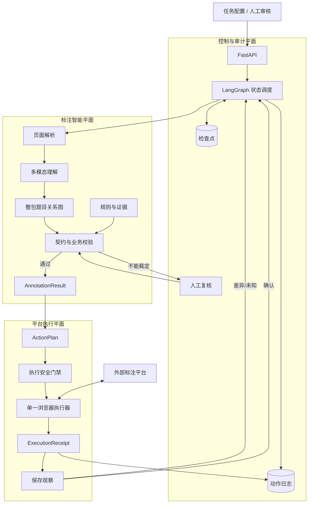

# 标注 Agent 最终设计总图

## 1. 三个平面



## 2. 主链路

```text
任务进入
→ 页面与身份确认
→ 页面解析
→ 题目结构理解
→ 题目关系图
→ 规则和契约校验
→ AnnotationResult
→ ActionPlan
→ 执行安全门禁
→ 浏览器执行
→ 保存观察
→ ExecutionReceipt
→ 状态推进、人工复核或重新采集
```

## 3. 当前实现边界

- 先做离线标注引擎；
- 再做 FakeExecutor；
- 再接测试平台；
- 最后考虑生产提交；
- 模型只生成候选；
- 程序负责坐标、关系、规则和契约；
- 人工处理低置信度和冲突。

完整说明见：[`ARCHITECTURE-DESIGN.md`](ARCHITECTURE-DESIGN.md)。
