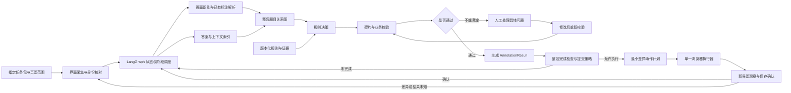

# 题目标注 Agent：参考图风格流程图

## 图中每个阶段的含义

| 节点 | 作用 |
|---|---|
| 指定任务包与页面范围 | 明确处理对象、学科、页面和任务边界 |
| 界面采集与身份核对 | 确认平台、账号、任务和当前页面状态 |
| LangGraph 状态与阶段调度 | 管理流程节点、状态、恢复、超时和人工介入 |
| 页面识别与已有标注解析 | 获取页面内容、坐标和平台已有标注 |
| 答案与上下文索引 | 整理答案页、二维码、听力材料和相关上下文 |
| 整包题目关系图 | 建立题目、子题、跨页和答案之间的关系 |
| 版本化规则与证据 | 提供学科、题型、答案来源和特殊条件规则 |
| 规则决策 | 根据关系图和规则确定应执行的标注动作 |
| 契约与业务校验 | 检查坐标、关系、格式和业务约束 |
| AnnotationResult | 输出经过校验的结构化标注结果 |
| 人工处理具体问题 | 处理模型不能裁定或规则冲突的情况 |
| 整包完成检查与提交策略 | 判断任务是否完整以及是否允许进入执行 |
| 最小差异动作计划 | 只规划必要的新增、修改、删除和关联操作 |
| 单一浏览器执行器 | 在受控的单一会话中执行平台动作 |
| 新界面观察与保存确认 | 验证页面变化、保存结果和下一步状态 |

## 这张图与参考图的关系

参考图中的“页面识别、答案与上下文、规则决策、契约校验、浏览器执行、保存确认”被保留；本项目增加了题目标注专属的：

- 题目框和答案框；
- 父子、跨栏、跨页关系；
- 回填答案；
- 题型和封闭性；
- `AnnotationResult`；
- 规则证据和金标准评测。

完整说明见：[`ARCHITECTURE-DESIGN.md`](ARCHITECTURE-DESIGN.md)。
