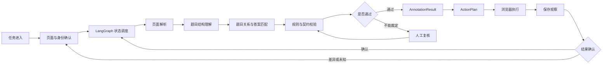
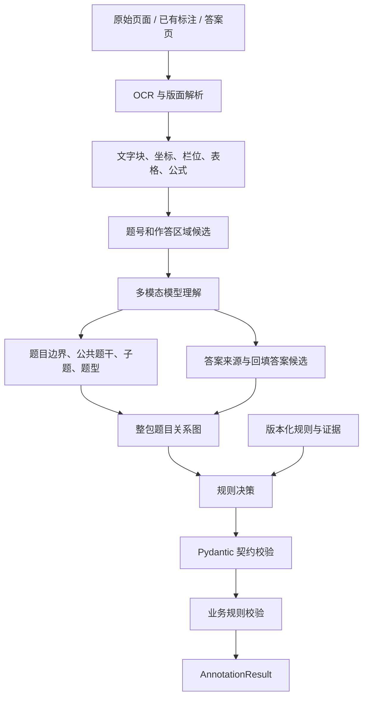
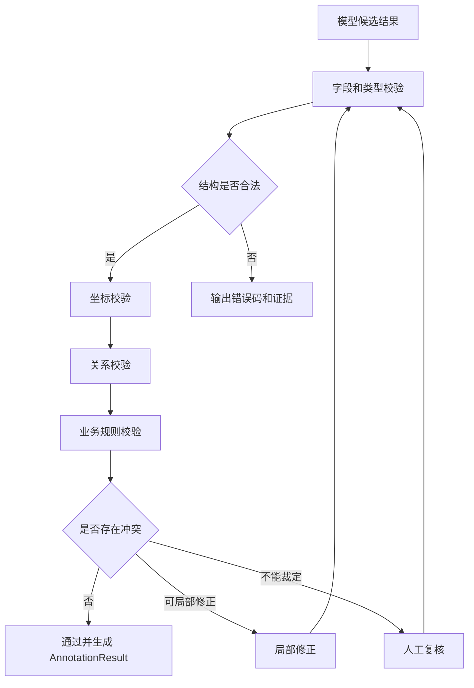
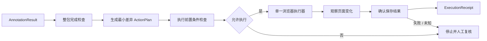
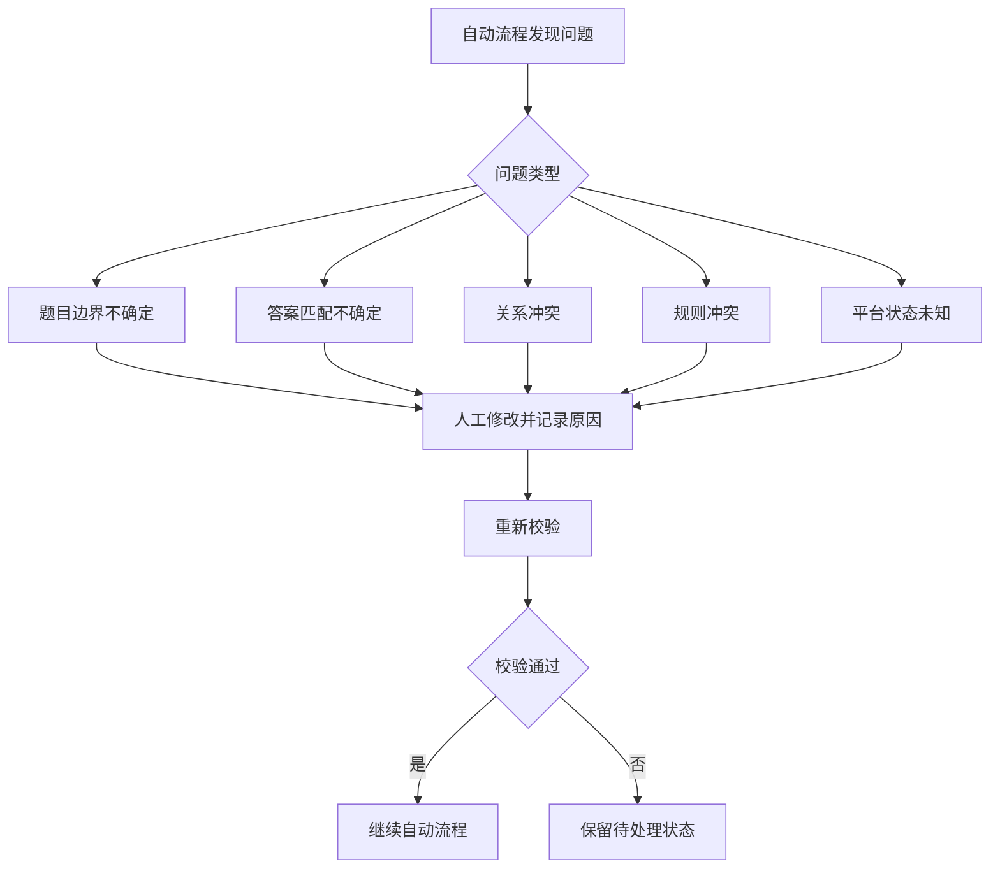
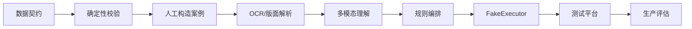
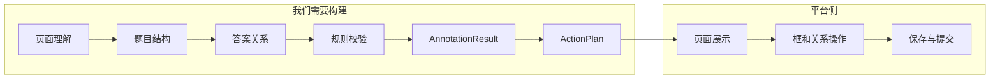

# 标注 Agent 流程图集

> 这不是新增系统，而是把总设计拆成几个容易理解、容易实现和容易排错的流程图。
>
> 总体详细说明见 [`ARCHITECTURE-DESIGN.md`](ARCHITECTURE-DESIGN.md)。

## 1. 总体端到端流程



### 这张图回答什么

回答系统从任务进入到最终确认的完整路径。它不展开每个技术细节，只说明系统的主干。

## 2. 标注智能流程



### 模型和程序的分工

```text
模型：提出“这可能是什么”
程序：检查“这个结果是否合法”
规则：决定“业务上应该怎么做”
```

## 3. 规则校验流程



### 质量门禁的原则

- 结构不合法，不能进入业务判断；
- 坐标不合法，不能生成动作；
- 关系冲突，不能静默通过；
- 低置信度，进入人工复核；
- 修正后必须重新校验。

## 4. 平台执行流程



### 执行器的限制

浏览器执行器不能：

- 自己猜测题型；
- 自己修改业务规则；
- 自由跳转未授权页面；
- 无限重试；
- 在没有保存确认时报告成功。

## 5. 人工复核流程



## 6. 开发实现顺序



不要跳过前面的阶段。特别是：

```text
没有 AnnotationResult，就不能设计可靠的 ActionPlan；
没有 ActionPlan，就不能安全接浏览器；
没有 FakeExecutor，就不应直接操作测试平台；
没有测试平台验证，就不应考虑生产提交。
```

## 7. 一张图看懂系统边界



核心边界：

```text
题目标注智能：我们负责
平台页面和最终保存：通过适配器受控调用
```
